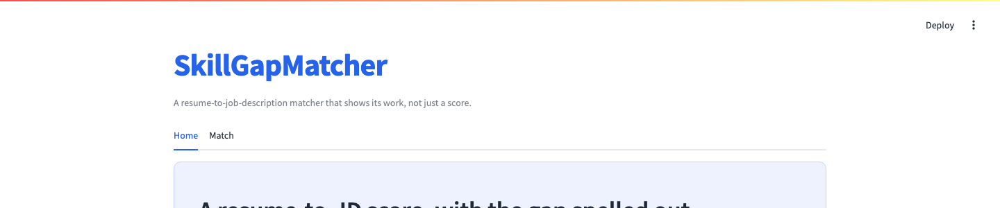

# SkillGapMatcher

An ATS-style resume-to-job-description matcher that shows its work instead of
handing back one opaque similarity number.

## Why this exists

Most resume-matching tools score a resume against a job description and stop
there — "72% compatible," with no way to tell *which* 28% is missing. That's
not useful to a candidate deciding what to add to a resume, or to a recruiter
deciding whether a gap is a dealbreaker. This tool parses both documents and
reports three real similarity scores *and* the actual skill-level
breakdown behind them: what matched, what the job wants that the resume
doesn't show, and what's on the resume that the job never asked for.

## Screenshots




## How it works

1. Paste a resume and a job description as plain text (a sample pair is
   pre-filled so the app is usable immediately — no file upload required to
   try it).
2. Both are parsed with [pydparser](https://github.com/Justicea83/pydparser)
   (vendored in `vendor/pydparser/`, MIT licensed — see
   `vendor/pydparser/ATTRIBUTION.md`), which uses spaCy NER models trained on
   resumes/JDs to pull out structured fields: name, skills, experience,
   occupation.
3. `matcher.py` takes the two skill sets and computes:
   - **Required skills covered** — matched skills ÷ all skills the JD asks for.
   - **Jaccard similarity** — matched skills ÷ the union of both skill sets.
   - **TF-IDF cosine similarity** — vectorizes each skill set and compares them.
4. The skills-gap breakdown — **matched**, **missing**, **extra** — is the
   actual differentiator over the base library, which computes similarity
   scores but never surfaces which specific skills drove them.

## Running it locally

```bash
python -m venv .venv
source .venv/bin/activate
pip install -r requirements.txt
python -m spacy download en_core_web_sm
python -c "import nltk; nltk.download('stopwords')"
streamlit run app.py
```

## Tests

```bash
python -m pytest tests/ -v
```

## Two real bugs found and fixed in the vendored library

Vendoring (rather than `pip install`-ing) `pydparser` meant actually reading
its source, which surfaced two bugs that would otherwise have shipped
silently:

- **No `.txt` support.** `utils.py`'s `extract_text()` only handled
  `.pdf`/`.docx`/`.doc` — but this app's entire UX is paste-as-plain-text.
  Added a `.txt` branch.
- **Unguarded dict access.** `job_parser.py` read `cust_tags['DOMAIN']` with
  no guard, unlike every other field extracted in the same function (all of
  which use `try`/`except` or `.get()`). Any job description with no
  recognized domain entity — a common case, not every posting states an
  industry explicitly — raised a bare `KeyError` and crashed the whole parse.
  Fixed to `cust_tags.get('DOMAIN')`.

Both are documented in `vendor/pydparser/ATTRIBUTION.md` alongside the exact
diff.

## A real limitation, not hidden

The NER-based skill extraction is sensitive to sentence position. In testing,
a job description that mentioned "Docker" in a separate sentence from its
main "experience with X, Y, Z" skill list sometimes failed to register Docker
as a *required* skill — even when the resume listed Docker too, it landed in
**extra** rather than **matched**, because the extractor didn't attribute it
to the JD's skill set. This is a precision limit of the underlying NER
approach, not a bug in the matching logic, and it's captured directly in
`tests/test_matcher.py` as documented, expected behavior rather than being
papered over by loosening the test.

## Project structure

```
app.py                  Streamlit UI
matcher.py              Scoring + skills-gap logic (the actual differentiator)
vendor/pydparser/       Vendored parsing library (MIT, see ATTRIBUTION.md)
tests/test_matcher.py   Unit tests, including the documented limitation above
```

## License

MIT — see `LICENSE`. The vendored `pydparser` code under `vendor/pydparser/`
is separately MIT licensed by its original author; see
`vendor/pydparser/LICENSE-pydparser.txt`.
