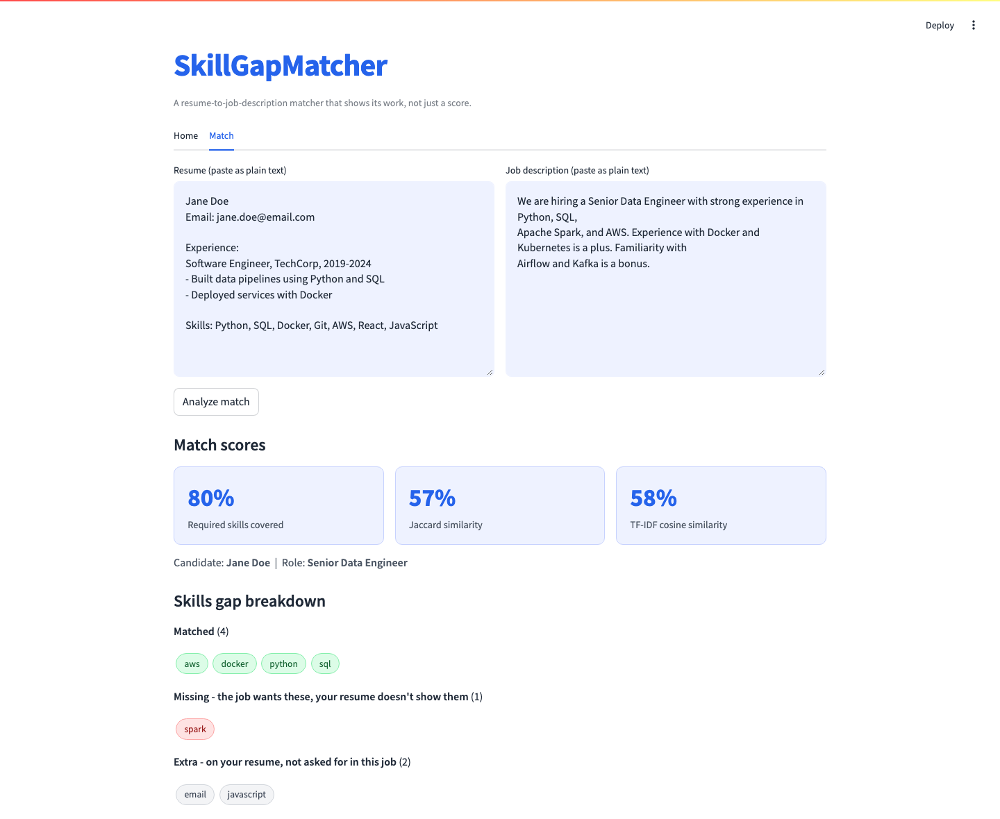

# SkillGapMatcher

    

An ATS-style resume-to-job-description matcher that shows its work instead
of handing back one opaque similarity number. It parses both documents with
NER and reports three real similarity scores alongside the actual
skill-level breakdown behind them - what matched, what the job wants that
the resume doesn't show, and what's on the resume the job never asked for.

## Screenshots



## How to run

```bash
python -m venv .venv
source .venv/bin/activate
pip install -r requirements.txt
python -m spacy download en_core_web_sm
python -c "import nltk; nltk.download('stopwords')"
streamlit run app.py
```

Tests: `python -m pytest tests/ -v`
